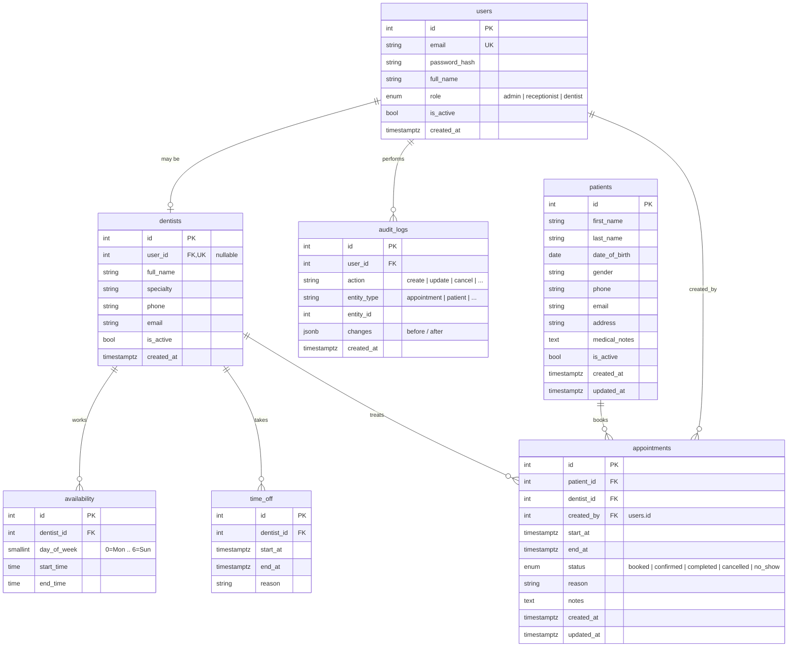

# DentalFlow — Database ERD (draft)

PostgreSQL. All timestamps are `timestamptz` (UTC). GitHub renders the diagram below.

## Key constraints
| Table | Constraint | Why |
|---|---|---|
| appointments | `CHECK (end_at > start_at)` | no zero/negative length |
| appointments | `EXCLUDE USING gist (dentist_id WITH =, tstzrange(start_at, end_at) WITH &&) WHERE (status NOT IN ('cancelled','no_show'))` | **double-booking prevention in the DB** (needs `btree_gist` extension) |
| availability | `CHECK (end_time > start_time)`, `CHECK (day_of_week BETWEEN 0 AND 6)` | valid blocks |
| time_off | `CHECK (end_at > start_at)` | valid period |
| users | `UNIQUE (email)` | login |
| dentists | `UNIQUE (user_id)` | one account per dentist |

## Indexes (initial)
- `appointments (dentist_id, start_at)` — calendar by dentist/date
- `appointments (patient_id, start_at)` — patient history
- `patients (last_name, first_name)`, `patients (phone)` — search
- `availability (dentist_id, day_of_week)`
- `audit_logs (entity_type, entity_id)`

## Notes
- Breaks are modelled as gaps between `availability` rows on the same day — no separate table.
- Nothing is hard-deleted except availability rows; patients/dentists use `is_active`.
